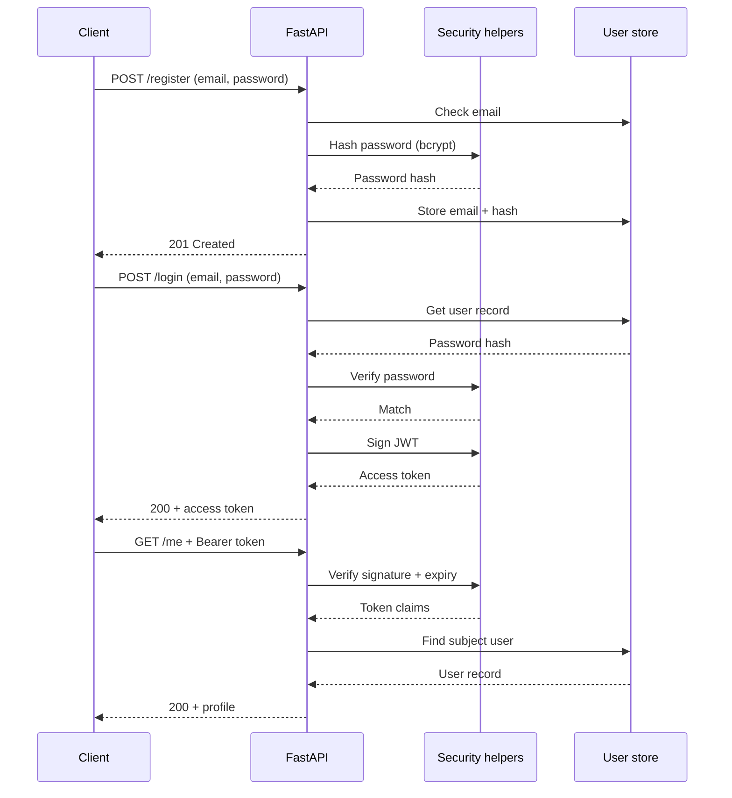

# Request Flow

## 1. Registration

1. Client sends email and password to `POST /register`.
2. FastAPI validates basic field lengths and the route checks the email shape.
3. The API checks whether the email already exists in the demo store.
4. `hash_password()` creates a bcrypt hash using a generated salt.
5. Only the email and password hash are stored.
6. API returns `201 Created`; the password and hash are not returned.

## 2. Login

1. Client sends email and password to `POST /login`.
2. API looks up the normalized email.
3. `verify_password()` compares the submitted password with the stored bcrypt hash.
4. If the account is missing or the password does not match, the API returns a generic `401 Unauthorized`.
5. If valid, `create_access_token()` signs a JWT with a subject (`sub`), issued-at (`iat`), and expiry (`exp`) claim.
6. API returns the access token and token type.

## 3. Protected profile request

1. Client calls `GET /me` with `Authorization: Bearer <access-token>`.
2. The HTTP bearer dependency extracts the token.
3. `decode_access_token()` verifies its signature and expiration.
4. API reads the subject claim and looks up the user.
5. If valid, API returns the user's email; otherwise it returns `401 Unauthorized`.

## Sequence diagram

## Failure cases

- Invalid registration data: `422`.
- Duplicate registration: `409`.
- Wrong email/password: `401`.
- Missing, invalid, or expired bearer token: `401`.

The sample deliberately uses generic login errors to avoid revealing whether an email address is registered.
